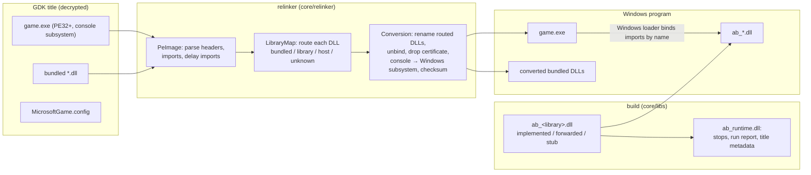

# AnyBox

## Status

Title 7952987A (version 1.0.2.1) boots through its first-run legal screens, plays its loading screen and loads into the game world. The world is drawn and lit, and the opening sequence plays for 35 minutes and more, at 1 to 2 fps on an 8 GB desktop GPU: the GPU spends most of each frame on title memory it reaches over the bus. Details: [Bring-up status](docs/dev/GAME_TESTING.md#bring-up-status).

<!-- docs:start -->
<details>
<summary><b>Usage</b> (<a href="docs/user/USAGE.md">docs/user/USAGE.md</a>)</summary>

AnyBox converts a **decrypted** GDK title, a folder holding the main `.exe`, its DLLs and `MicrosoftGame.config`, into a program that runs on Windows. It does not decrypt or unpack protected packages.

## Convert

```
anybox-relinker --libs build/libs --module-dir . --registry <package>\game.exe <out>\game.exe
```

| Option | Meaning |
|---|---|
| `--libs <dir>` | copy the AnyBox DLLs the output needs (from `build/libs`) beside it |
| `--module-dir <dir>` | also convert every `.dll` under `<dir>` (relative to the package); repeat for each folder of title DLLs; `.` converts those beside the executable |
| `--registry` | write `<file>.registry.json` with every import and where it is routed |
| `--console` / `--gui` | choose the Windows subsystem (console images become GUI by default) |
| `--allow-unknown` | keep imports from DLLs nothing provides instead of failing |
| `--list-imports` | print the imports and their routes, write nothing |
| `--print-map` | print the DLL routing table |

Then copy the rest of the package (data folders and `MicrosoftGame.config`) into `<out>`. The relinker prints the expected layout.

## Convert and run in one step

```
python tools/launch_title.py <package> <out> --build-dir build
```

checks that the executable named in `MicrosoftGame.config` is a decrypted PE32+ x64 image, converts it with `--module-dir` for every folder holding DLLs, hard-links (or copies) the rest of the package into `<out>` except `.xvd` containers, starts the program with `ANYBOX_LOG_FILE=<out>\anybox.log`, and prints the run report summary. `--exe <path>` picks the executable when the config lists several, `--console` uses the console subsystem, and `--no-run` stops after converting.

## Before converting: audit

```
python tools/import_audit.py <package>
```

lists every import that is a stub, absent or unrouted, and exits with 1 if the title cannot start yet.

## Run

Start `<out>\game.exe`. When the title stops, `anybox-report.json` beside it says why:

| `stop.kind` | Exit code | Meaning |
|---|---|---|
| `none` | the title's | the process exited normally |
| `not-implemented` | `0xAB01` | the title called a stub; `library` and `function` name it |
| `unsupported` | `0xAB02` | an implemented function met a case whose behaviour is unknown; `message` says which |
| `crash` | the exception code | an unhandled exception; `exception` gives the module and offset |

`python tools/run_report_summary.py anybox-report.json` checks the report and prints one line to paste into the title's Game bring-up thread.

## Environment

| Variable | Effect |
|---|---|
| `ANYBOX_REPORT=<path>` | write the run report there instead of beside the executable |
| `ANYBOX_NO_REPORT=1` | write no run report |
| `ANYBOX_LOG_FILE=<path>` | append AnyBox's log lines to this file as well as stderr |
| `ANYBOX_TRACE=<library>[,<library>...]` | log every call into the listed AnyBox libraries (`xmem`, `d3d12_x`, ...; `all` for every library) with its arguments and result; case and spaces are ignored. Libraries that trace so far: `xmem`, `d3d12_x` |
| `ANYBOX_SHADER_STORE=<folder>` | load the shader store from this folder instead of `shaders` beside the executable ([GAME_TESTING](docs/dev/GAME_TESTING.md#shader-store)) |

</details>

<details>
<summary><b>Build</b> (<a href="docs/dev/BUILD.md">docs/dev/BUILD.md</a>)</summary>

## Requirements

- CMake 3.20 or newer and Ninja.
- A C++20 compiler.
  - **Full build (Windows):** MinGW-w64 GCC 13 or newer (tested with WinLibs GCC 15.2 UCRT, POSIX threads, SEH) or MSVC 2022. MSVC needs a Windows SDK that provides `xaudio2.lib` (checked with 10.0.26100).
  - **Relinker only (any OS):** GCC, Clang or MSVC.
- Python 3.10 or newer for the tool tests and the end-to-end tests (optional; without it those tests are not registered). `pip install jsonschema` enables the schema check of run reports.

## Full build (Windows)

The libraries need the submodules under `3rdparty/` (Vulkan-Headers). Clone with `git clone --recursive`, or run `git submodule update --init` in an existing clone.

```
cmake -S . -B build -G Ninja -DCMAKE_BUILD_TYPE=Release -DBUILD_TESTING=ON
cmake --build build
ctest --test-dir build --output-on-failure
```

Outputs:

- `build/anybox-relinker.exe`
- `build/anybox-module-probe.exe`, used by `tools/module_check.py`
- `build/anybox-gpu-report.exe`, used by `tools/gpu_report.py`
- `build/anybox-pipeline-probe.exe`, which creates `d3d12_x`'s Vulkan device and compiles compute pipelines (`layout`, `selftest`, `validation`, `compile`, `bindless`, `window`)
- `build/libs/ab_*.dll`, including `ab_runtime.dll`
- `build/libs/anybox-libs.map`, the DLL routing table

## Shaders (optional)

With `-DANYBOX_GAME_PACKAGE` and `-DANYBOX_SHADER_TRANSLATOR`, the build gets `shaders` and `shader_pipelines` targets that build a title's shader set from your own package into `build/shaders`, and tests labelled `shaders` that check it. See [Building shaders with the project](docs/dev/GAME_TESTING.md#building-shaders-with-the-project).

## Probe shaders

The probes run a few test shaders, compiled ahead of time so the build needs no shader compiler. Each `core/libs/probe/shaders/<name>.<stage>` (`.comp`, `.vert` or `.frag`) sits next to its compiled `<name>.inc`; after editing one, regenerate it with the Vulkan SDK's `glslc`:

```
glslc --target-env=vulkan1.3 -O -mfmt=num core/libs/probe/shaders/<name>.<stage> -o core/libs/probe/shaders/<name>.inc
```

## Relinker only

Builds and tests the converter without the Windows libraries, on Linux, macOS or Windows:

```
cmake -S . -B build -G Ninja -DANYBOX_RELINKER_ONLY=ON -DBUILD_TESTING=ON
cmake --build build
ctest --test-dir build --output-on-failure
```

## After adding a library

The routing table and the library list are read at configure time. Re-run the `cmake -S . -B build` step after you add a folder under `core/libs/xdll` or edit an `Imports.txt` or `Ordinals.txt`. `CONFIGURE_DEPENDS` makes the build re-run it automatically in most generators.

</details>

<details>
<summary><b>Architecture</b> (<a href="docs/dev/ARCHITECTURE.md">docs/dev/ARCHITECTURE.md</a>)</summary>

How a GDK executable becomes a Windows program. Nothing is emulated: the converted executable runs as a normal process and calls native implementations of the system libraries.

## Overview



## Why this works for GDK

- GDK titles are x86-64 PE32+ images, the format the Windows loader already reads. There is no instruction translation and no ABI thunking: Windows x64 has one calling convention, and console and PC code both use it.
- What differs is the environment: the subsystem field (14, the console subsystem), the console-only system DLLs the title imports (XGameRuntime, D3D12.X, kernelx and others), and the hardware behind them.

## Relinker

[`Conversion::Convert`](core/relinker/relinker/src/Conversion.cpp), called from [`main.cpp`](core/relinker/main.cpp):

1. **Parse.** [`PeImage`](core/relinker/pe/src/PeImage.cpp) reads the headers, sections, import and delay-import descriptors (by name and by ordinal) and exports. Only AMD64 PE32+ native images are accepted.
2. **Route.** [`LibraryMap`](core/relinker/relinker/src/LibraryMap.cpp) resolves each imported DLL, first match wins:
   1. **bundled:** a DLL the title ships, from the input's folder or a `--module-dir`. Its name is kept, and it is converted too.
   2. **library:** a pattern in some `core/libs/xdll/<name>/Imports.txt`. The import is renamed to `ab_<name>.dll`.
   3. **host:** a pattern in [`HostDlls.txt`](core/relinker/HostDlls.txt): the desktop OS provides it unchanged (API sets, the CRT, `kernel32`).
   4. **unknown:** conversion fails and names the DLL, unless `--allow-unknown`.
   An import by ordinal from a library must be pinned in that library's `Ordinals.txt`, or conversion fails and names it.
   CMake generates the table from these files at configure time ([`cmake/LibraryMap.cmake`](cmake/LibraryMap.cmake)), so adding a library needs no relinker change.
3. **Rewrite.** New DLL names go in an appended `.abximp` section, and each descriptor's name RVA is pointed at them. Descriptors, thunks and the IAT stay where they are, so code that calls through the IAT is unaffected. Bound imports are unbound (the IAT is restored from the lookup table). The Authenticode certificate is dropped, because the image no longer matches it. The subsystem becomes Windows GUI (or console with `--console`), and the checksum is recomputed.
4. **Report.** `--registry` writes `<output>.registry.json` with every import and its route; `tools/import_audit.py` reads PE files directly for the same view against the library sources.

## Libraries

- Each folder in [`core/libs/xdll`](core/libs/xdll) builds `ab_<name>.dll` through `anybox_add_xdll` ([`core/libs/CMakeLists.txt`](core/libs/CMakeLists.txt)).
- An export is one of:
  - **implemented:** an `ABX_API` definition (`extern "C" __declspec(dllexport)`);
  - **forwarded:** a `Name=hostdll.Name` line in `Forwards.def`, which the Windows loader resolves to the host DLL;
  - **stub:** an `ABX_API` definition whose body calls `AbxNotImplemented(__func__)`.
- [`ab_runtime.dll`](core/libs/runtime/src/Runtime.cpp) is shared by every library:
  - `AbxNotImplemented` / `AbxUnsupported` log the library and function, write the run report and end the process with exit code `0xAB01` / `0xAB02`. A title cannot catch these.
  - An unhandled exception filter writes the report for crashes (code, address, module and offset).
  - At normal process exit the report is written with `stop.kind = "none"`.
  - `AbxTitleId()`, `AbxTitleName()` and `AbxTitleDeviceFamily()` read `MicrosoftGame.config` beside the executable.
  - `AbxTrace(format, ...)` logs through `AbxLog` on the library's channel when `ANYBOX_TRACE` lists that library (or `all`); each call site asks `AbxTraceEnabled` once, so a trace that is off costs one branch.
  - Each library registers itself at load ([`Registration.cpp`](core/libs/runtime/src/Registration.cpp)), so the report lists the libraries the title loaded.
  - The relinker only changes import tables, so a DLL a title loads by name at run time would bypass it: GDK modules load `xgameruntime.dll` with `LoadLibraryExW` and System32-only search, which on a PC with Gaming Services finds the desktop runtime. [`LoaderRedirect.cpp`](core/libs/runtime/src/LoaderRedirect.cpp) points the `LoadLibrary*` and `GetModuleHandle*` import slots of title-side modules (not AnyBox's `ab_*` libraries, not Windows modules) at functions that send any name AnyBox serves to its library beside `ab_runtime.dll`, using the same routes as the relinker; modules loaded later are patched from the loader's DLL notification. Each redirected name is logged once with its caller.
- Libraries link their C and C++ runtime statically, with MinGW and with MSVC (`CMAKE_MSVC_RUNTIME_LIBRARY`), so the output folder needs no compiler DLLs, and AnyBox never loads the console builds of `msvcp140.dll` and `vcruntime140.dll` that titles ship beside their executable.

## Graphics (d3d12_x)

Console shaders carry native GPU code and no DXIL, so `d3d12_x` cannot hand them to a desktop driver. The design is on [#4](https://github.com/Dark3581/AnyBox/issues/4): the title's D3D12.X device goes to Vulkan, and its shaders are SPIR-V modules translated ahead of time by a separate tool. `d3d12_x` uses two back ends:

- **Host `d3d12.dll`** ([`RootSignature.cpp`](core/libs/xdll/d3d12_x/RootSignature.cpp)): `D3D12SerializeRootSignature` and `D3D12SerializeVersionedRootSignature` (with the console-only flag bits cleared) and the two deserializer creators are forwarded to it, since they need no GPU.
- **Vulkan** (`vulkan/`, `pso/`, `store/`): everything the device does. `D3D12XboxCreateDevice`, `D3D12CreateDevice` and `D3D12GetDebugInterface` still stop the title until its calls show the device's shape, so nothing reaches the pieces below yet.

- **Shader store** ([`store/ShaderStore.cpp`](core/libs/xdll/d3d12_x/store/ShaderStore.cpp)): modules keyed by the SHA-256 of each DXBC container, loaded from `ANYBOX_SHADER_STORE` or `shaders` beside the executable. [`tools/build_shaders.py`](tools/build_shaders.py) and the `shaders` target build it from a package ([GAME_TESTING](docs/dev/GAME_TESTING.md#building-shaders-with-the-project)).
- **Device** ([`vulkan/VulkanDevice.cpp`](core/libs/xdll/d3d12_x/vulkan/VulkanDevice.cpp)): a Vulkan 1.3 device with exactly the features the store's modules name; [`VulkanBackend.cpp`](core/libs/xdll/d3d12_x/vulkan/VulkanBackend.cpp) reports what each GPU offers (`anybox-gpu-report`, `tools/gpu_report.py`).
- **Layout** ([`vulkan/TitleLayout.cpp`](core/libs/xdll/d3d12_x/vulkan/TitleLayout.cpp)): every pipeline uses one layout, set 0 with twenty bindless bindings and 144 bytes of push constants, the interface the translated modules declare (`tools/spirv_layout.py` checks a store against it).
- **Pipelines** ([`vulkan/PipelineCompiler.cpp`](core/libs/xdll/d3d12_x/vulkan/PipelineCompiler.cpp)): compute pipelines from stored modules, a pipeline cache reused only on the same GPU and driver, and large modules compiled one at a time.
- **Pipeline state** ([`pso/PipelineState.cpp`](core/libs/xdll/d3d12_x/pso/PipelineState.cpp), [`vulkan/PipelineLibrary.cpp`](core/libs/xdll/d3d12_x/vulkan/PipelineLibrary.cpp)): a compute pipeline state description is resolved to its stored module through the hash of its shader container, and the library creates each pipeline once, cache first. It asks the driver for the pipeline without compiling (`VK_PIPELINE_CREATE_FAIL_ON_PIPELINE_COMPILE_REQUIRED_BIT`); only when that fails does it compile, and a module over the run-time compile limit is refused instead. Some modules need more memory to compile than a PC can commit, so the offline `shader_pipelines` run fills the cache that the title then only loads. The title's own cached pipeline blobs are ignored, because they hold console GPU code.
- **Graphics state** ([`pso/GraphicsState.cpp`](core/libs/xdll/d3d12_x/pso/GraphicsState.cpp), [`vulkan/GraphicsPipeline.cpp`](core/libs/xdll/d3d12_x/vulkan/GraphicsPipeline.cpp)): a graphics pipeline state description's blend, rasterizer, depth-stencil, sample, topology class and target formats become Vulkan state, and pipelines use dynamic rendering. Viewports, scissors, blend constants, stencil reference, the exact topology, primitive restart and vertex buffer strides are dynamic, because D3D12 sets them while recording. `GraphicsPipelineRequest` ([`pso/PipelineState.cpp`](core/libs/xdll/d3d12_x/pso/PipelineState.cpp)) resolves a graphics description's vertex, geometry and pixel shaders through the store and hands the whole pipeline to the library, cache first like compute.
- **Root signatures** ([`pso/RootSignatureLayout.cpp`](core/libs/xdll/d3d12_x/pso/RootSignatureLayout.cpp)): a root signature blob is deserialized through the host `d3d12.dll` and laid out as parameters with their 32-bit word cost, tables and ranges, and static samplers as Vulkan samplers; the mapping of those words to the shaders' user registers is still open.
- **Vertex input** ([`pso/VertexInput.cpp`](core/libs/xdll/d3d12_x/pso/VertexInput.cpp)): a translated vertex shader reads each input at the location of its D3D input register, so the input layout is matched to the vertex shader's inputs by semantic name and index, which the store keeps in `inputs.txt`.
- **Resource states** ([`commands/ResourceState.cpp`](core/libs/xdll/d3d12_x/commands/ResourceState.cpp)): D3D12 resource states become Vulkan stages, access masks and image layouts, so a transition, UAV or aliasing barrier becomes a `vkCmdPipelineBarrier2` dependency (the device enables `synchronization2`).
- **Objects** ([`objects/`](core/libs/xdll/d3d12_x/objects)): COM objects implementing the public D3D12 interfaces on Vulkan, with reference counting, private data and names ([`ObjectBase.hpp`](core/libs/xdll/d3d12_x/objects/ObjectBase.hpp)). `ID3D12Fence1` is a timeline semaphore; `ID3D12CommandQueue` signals and waits on the one Vulkan queue and holds a wait on the CPU until its value is promised, so a wait recorded before its signal cannot deadlock. `ID3D12CommandAllocator` is a Vulkan command pool and `ID3D12GraphicsCommandList` records into one of its command buffers through the command recorder, tracking the states its barriers set so copies use the right layouts; `ExecuteCommandLists` queues the closed lists' buffers in order with the queue's signals and waits, and `Close` ends each list with a barrier that makes GPU writes visible to the CPU, as a D3D12 readback after a fence expects. `ID3D12DescriptorHeap` ([`DescriptorHeap.cpp`](core/libs/xdll/d3d12_x/objects/DescriptorHeap.cpp)) puts shader-visible heaps in the buffer window, so a GPU descriptor handle is the address the shaders read descriptor words from, and keeps a CPU-side record of the Vulkan view or sampler behind each slot; [`DescriptorWriter.cpp`](core/libs/xdll/d3d12_x/objects/DescriptorWriter.cpp) writes buffer descriptors, creates render target, depth-stencil and texture views (cached per resource) and samplers, and copies descriptors. The handle increments are the console's and stay unset until a title gives them ([`DescriptorSizes.cpp`](core/libs/xdll/d3d12_x/resources/DescriptorSizes.cpp)). `ID3D12RootSignature` ([`RootSignature.cpp`](core/libs/xdll/d3d12_x/objects/RootSignature.cpp)) holds the deserialized layout and `ID3D12PipelineState` ([`PipelineObject.cpp`](core/libs/xdll/d3d12_x/objects/PipelineObject.cpp)) a pipeline from the library; a command list binds pipeline states and keeps each bind point's root arguments as root words at the layout's offsets. Draws and dispatches wait for the mapping from those words to the translated shaders' push constants. `ID3D12Resource` ([`Resource.cpp`](core/libs/xdll/d3d12_x/objects/Resource.cpp)) puts committed buffers in the buffer window (first-fit, [`vulkan/BufferArena.cpp`](core/libs/xdll/d3d12_x/vulkan/BufferArena.cpp)), so their GPU addresses are what the shaders add the heap base to, and textures in their own device memory, zeroed and moved to their initial state at creation. Built with MinGW, methods that return a structure use the explicit return pointer the console's MSVC ABI expects.
- **Command recording** ([`commands/CommandRecorder.cpp`](core/libs/xdll/d3d12_x/commands/CommandRecorder.cpp), [`commands/CopyLayout.cpp`](core/libs/xdll/d3d12_x/commands/CopyLayout.cpp)): clears, buffer and texture copies through placed footprints, texture copies, resolves, render passes, viewports (with a negative height, so D3D12's winding applies), scissors, topology, vertex and index buffers, push constants, draws, dispatches and indirect draws and dispatches ([`commands/IndirectCommands.cpp`](core/libs/xdll/d3d12_x/commands/IndirectCommands.cpp), with count buffers) recorded on a Vulkan command buffer, with layouts from the D3D12 states.
- **Textures** ([`resources/TextureDesc.cpp`](core/libs/xdll/d3d12_x/resources/TextureDesc.cpp)): a texture's resource description becomes a Vulkan image description, with typeless and block-compressed formats, depth families, mip chains, multisampling and cube compatibility.
- **Views and samplers** ([`resources/ViewDesc.cpp`](core/libs/xdll/d3d12_x/resources/ViewDesc.cpp)): shader resource, unordered access, render target and depth-stencil view descriptions become Vulkan image views (format family, depth or stencil aspect, swizzle, mip and array range), and sampler descriptions become Vulkan samplers.
- **Buffer descriptors** ([`resources/BufferDescriptor.cpp`](core/libs/xdll/d3d12_x/resources/BufferDescriptor.cpp)): constant buffer and buffer shader resource and unordered access views become the four-word buffer descriptors the translated shaders decode (base address, stride, records, component selects, format and bounds mode).
- **Memory access** in a translated shader takes one of two paths:
  - images and samplers: the shader looks its T# or S# up in the descriptor hash table at binding 2 ([`vulkan/DescriptorTable.cpp`](core/libs/xdll/d3d12_x/vulkan/DescriptorTable.cpp)) and gets a bindless index into set 0 ([`vulkan/BindlessSet.cpp`](core/libs/xdll/d3d12_x/vulkan/BindlessSet.cpp)), with fallbacks at index 0;
  - buffers and scalar loads: the shader adds the heap base to the console address it read, so a title's buffers and descriptor tables have to sit in one buffer-device-address range, below 4 GB for descriptor tables ([`vulkan/TitleBufferWindow.cpp`](core/libs/xdll/d3d12_x/vulkan/TitleBufferWindow.cpp)).
- `anybox-pipeline-probe` drives each piece on the GPU (`selftest`, `validation`, `bindless`, `window`, `compile`); the `pso_probe` test program drives pipeline state descriptions through the store and the library.

Since the first title bring-up, the device's methods, command queues and lists, resources, descriptor heaps and presentation are built, and a title reaches its game world (see [Bring-up status](docs/dev/GAME_TESTING.md#bring-up-status)). Points added during that bring-up:

- **Mesh pipelines**: a pipeline stream whose subobject 24 (amplification on the desktop) holds a shader the store lists as a mesh shader, with no subobject 25, is built as a mesh pipeline. A mesh stage reads its root words from s16 and the pixel stage from s8, so the mesh module's register reads are moved down by 8 when the pipeline is created ([`vulkan/UserDataRebase.cpp`](core/libs/xdll/d3d12_x/vulkan/UserDataRebase.cpp)). Mesh dispatches and indirect mesh dispatches are recorded as `vkCmdDrawMeshTasks*EXT`.
- **Indirect argument check** ([`commands/IndirectClamp.cpp`](core/libs/xdll/d3d12_x/commands/IndirectClamp.cpp)): indirect dispatch and mesh dispatch records are copied and checked on the GPU first; a record over the device's group limits runs empty instead of hanging the GPU.
- **Pipeline builds**: compute pipelines build in the background; graphics pipelines build in the background only when the pipeline cache already holds them, and otherwise when a draw first uses them, so loading does not wait behind pipelines the title may never draw with.
- **Title textures**: textures in title memory are uploaded again when their memory changes; uploads are submitted without waiting for the GPU, and their staging memory is freed when the batch's fence signals.

Each open point is in [debt/d3d12_x.md](docs/dev/debt/d3d12_x.md).

## Run report

`anybox-report.json`, schema [docs/run-report.schema.json](docs/run-report.schema.json), fixtures in [docs/run-report-fixtures](docs/run-report-fixtures). A value the runtime cannot know is `null`, never a guess.

## Tests

- [`relinker_tests`](core/relinker/tests/RelinkerTests.cpp) build synthetic console PE images in memory ([`SyntheticPe.cpp`](core/relinker/tests/SyntheticPe.cpp)) and check routing, unbinding, certificate removal, delay imports, header room and checksums.
- [`e2e.py`](core/libs/tests/e2e.py) takes a real title built against a stand-in console `xgameruntime.dll`, marks it with the console subsystem, relinks it, runs it on the AnyBox libraries, and checks its output and run report for a working task queue run, composite queues sharing ports, task queue monitors and waiters (including a monitor unregistering itself and a termination waited from the queue's own dispatched callback), XAsync calls (run, wait, provider ops, results, cancellation, a terminated queue and a null block), XGameSave containers and blobs written, read, enumerated and deleted in a per-title folder, XGameSaveFiles handing that folder to the title with a quota shared with XGameSave and a mismatch error when a title mixes the two, persistent local storage in its own per-title folder beside the saves (path and buffer sizes, kept across runs, separate per title, used bytes measured on the folder and free space read from the host volume), a stub stop, an unsupported stop, a crash and the reported device type.

</details>

<details>
<summary><b>Game testing</b> (<a href="docs/dev/GAME_TESTING.md">docs/dev/GAME_TESTING.md</a>)</summary>

Every run is useful, including one that stops at once: the run report names the next function to implement. This page asks for the same information from every run, so reports can be compared.

## Before a run

- Build `main` (or the pull request you are testing) in a clean tree: `cmake --build build`.
- Audit the title first: `python tools/import_audit.py <package> --json audit.json`. Keep the summary line for the report.
- Convert with `--registry` and every folder of title DLLs as `--module-dir` ([USAGE](docs/user/USAGE.md)).
- Check that the converted DLLs load: `python tools/module_check.py <out> --build-dir build`. Each DLL with a `.registry.json` beside it (every DLL except AnyBox's `ab_*.dll` when none has one) is loaded by `anybox-module-probe.exe` in its own process, which runs its `DllMain`. A DLL that fails names the Win32 error and, when `DllMain` raised one, the exception code with module and offset; one that calls a stub names the AnyBox function. It needs no executable, so it also works on a package whose executable is missing.
- Check the GPU against the title's shader store ([Shader store](docs/dev/GAME_TESTING.md#shader-store)): `python tools/gpu_report.py --build-dir build --store <out>\shaders`. It lists each Vulkan device and every feature, push constant size, subgroup operation per stage or 64-wide subgroup the store's modules need and the device lacks. Without `--store` it lists the devices only.
- Run one title at a time.

## Run

```
set ANYBOX_LOG_FILE=%CD%\anybox.log
out\game.exe
echo exit=%ERRORLEVEL%
```

## Report

Post to the title's **Game bring-up** discussion (one thread per title ID; search first):

- the line from `python tools/run_report_summary.py out\anybox-report.json`;
- the import audit summary line;
- the AnyBox commit and any pull requests merged on top;
- OS, CPU, GPU and driver;
- what was on screen and how far it got.

Attach `anybox-report.json` and the log. Never attach game files, executables, keys or anything you do not have the right to share.

## What to read

| Check | Where | Meaning |
|---|---|---|
| Exit code | shell | `0xAB01` (43777) stub, `0xAB02` (43778) unsupported, `0xC0000005` access violation, `0xC0000135` a DLL is missing beside the executable |
| Stop | `anybox-report.json` `stop` | the library and function, or the crash module and offset |
| Caller | `anybox-report.json` `stop.caller`, log line `called from` | where in the title the stop was reached: the first frame outside AnyBox and Windows, as `module+offset` (null when the title is not on the stack, for example on an AnyBox worker thread) |
| Frames | `anybox-report.json` `stop.frames`, log lines `#00`, `#01`, ... | up to 32 frames of the stopping or crashing thread |
| Run-time loads | log lines `loader: LoadLibraryExW(xgameruntime.dll) from game.exe+0x... loads ab_xgameruntime.dll` | a module loaded a DLL AnyBox serves by name at run time, and got AnyBox's library instead of whatever the search would have found |
| Libraries | `anybox-report.json` `libraries` | which AnyBox DLLs the title loaded |
| Log | stderr or `ANYBOX_LOG_FILE` | `[anybox] not implemented: lib!func (file:line)` |
| Loader errors | message box at start-up | "The procedure entry point X could not be located in Y": a forwarded or host export the desktop lacks; report it as a library gap |

## Debugging a stop

A stop names the AnyBox function and, under `caller`, the place in the title that reached it, such as `called from game.exe+0x31013`. The relinker leaves the title's sections where they were, so that offset is the same RVA in the original executable: in Ghidra or IDA, go to the image base plus the offset (`0x140000000 + 0x31013` for the usual base). Frames are return addresses, so the offset is the instruction just after the call; the call is the instruction before it. A crash lists its frames the same way, starting at the faulting instruction.

To look at the title's state at the stop, run it under a debugger (x64dbg, WinDbg or Visual Studio). With a debugger attached, a stop breaks into it before the process exits, with the title's call on the stack; set `ANYBOX_BREAK=0` to turn that off. When something else starts the title, set `ANYBOX_WAIT_DEBUGGER=<seconds>`: AnyBox logs its process ID, waits up to that long for a debugger to attach, and breaks before the title's entry point runs. The debugger also receives its own attach break, so continue past both.

| Variable | Effect |
|---|---|
| `ANYBOX_LOG_FILE=<path>` | append the log to a file as well as stderr |
| `ANYBOX_TRACE=<library>[,<library>...]` or `all` | log each traced call of those libraries |
| `ANYBOX_REPORT=<path>` | write the run report there instead of beside the executable |
| `ANYBOX_NO_REPORT=1` | write no run report |
| `ANYBOX_BREAK=0` | do not break into an attached debugger at a stop |
| `ANYBOX_WAIT_DEBUGGER=<seconds>` | wait for a debugger at start-up, then break before the title starts |
| `ANYBOX_CONFIG=<path>` | read settings from that file instead of `anybox.cfg` beside the executable |
| `ANYBOX_SET=<key>=<value>[;...]` | set or override settings for one run |

## Settings for values found during bring-up

Some values AnyBox needs depend on the console build a title was made for and are not known until someone finds them in that title; until then the feature that needs one stops with a message naming the missing value. Such values are settings, so trying one needs no rebuild. Put them in `anybox.cfg` beside the executable, one `key = value` per line, with a `#` comment saying where each came from:

```
# <title> <version>: GetDescriptorHandleIncrementSize result, seen at game.exe+0x1a2b30
d3d12_x.descriptor_size.shader_resource = 32
```

Each value a library reads is logged with its source (`setting ... = 32 (from anybox.cfg:2)`), and malformed or repeated lines are logged too. `ANYBOX_SET` overrides the file for one run. A setting describes one title's build: report what you found in the title's bring-up thread, and a value only becomes a default in AnyBox once it is confirmed and its source recorded.

| Key | Meaning |
|---|---|
| `d3d12_x.descriptor_size.shader_resource` | descriptor handle increment of CBV, SRV and UAV heaps, in bytes |
| `d3d12_x.descriptor_size.sampler` | descriptor handle increment of sampler heaps |
| `d3d12_x.descriptor_size.render_target` | descriptor handle increment of render target heaps |
| `d3d12_x.descriptor_size.depth_stencil` | descriptor handle increment of depth-stencil heaps |
| `d3d12_x.vulkan_device` | part of the name of the GPU to use, case-insensitive, when several are installed (`python tools/gpu_report.py` lists them); without it the best native GPU is used, and a layered driver such as Dozen only when nothing else can run the title |
| `d3d12_x.pipeline_cache` | path of the Vulkan pipeline cache file, loaded at start and saved while pipelines are built, so later runs do not compile them again |
| `d3d12_x.pipeline_workers` | background pipeline build threads, 1 to 64 (default: half the hardware threads), at lowest priority, plus one thread for pipelines over 2 MiB of SPIR-V |
| `d3d12_x.texture_reduce_above_mib` | texture memory, in MiB, past which large title textures are created without their top mip (default 4608, `0` turns it off); lower values save video memory and look visibly blurrier |
| `d3d12_x.clamp_indirect_dispatches` | `0` turns off the GPU-side check of indirect dispatch records |
| `d3d12_x.indirect_dispatch_guard` | `1` skips indirect compute dispatches in a frame where compute work was skipped |
| `d3d12_x.frame_interval_us` | present pacing interval in microseconds, used instead of the interval the title asks for |
| `runtime.title_watchdog_pause_rva` | RVA (hex) of the byte that pauses the title's own hang watchdog; AnyBox writes 1 there every 250 ms. Build-specific: record where it was found |

## Static analysis with Ghidra

When a title stops in a stub, the next question is what it passes to that function. [`tools/ghidra/ImportCallArgs.java`](tools/ghidra/ImportCallArgs.java) lists every call a title's executable or DLL makes into one imported DLL, and the instructions that set `RCX`, `RDX`, `R8` and `R9` before each call. Run it headless on the original (unconverted) file, with Ghidra 11 or later:

```
analyzeHeadless <project dir> anybox -import <package>\Bink2Scarlett.dll -scriptPath tools\ghidra -postScript ImportCallArgs.java xmem.dll calls.txt -overwrite
```

The output names each call site, its function and the argument setup, for example `RDX <- MOV EDX,0x5e50000` for the attributes passed to `XMemAlloc`. Use it to find which inputs a title exercises and to check a signature against real callers. Values seen in one title describe that title only: implement the function for every input, and put the call sites in the pull request, not in the repository.

## GDK runtime method tables

GDK modules do not import the runtime's functions: they load `xgameruntime.dll` at run time and call method tables that `QueryApiImpl` returns, so the run report names an interface and slot instead of a function. [`tools/api_impl_scan.py`](tools/api_impl_scan.py) lists, for one executable or DLL, every thunk the module contains (the GUID pair it passes to `QueryApiImpl` and the method slot it calls), and for the thunks the module's own code calls, how many call sites they have and which argument registers and stack slots each passes:

```
python tools/api_impl_scan.py <package>\game.exe --json game-apis.json
```

It needs GNU `objdump` on `PATH` (MinGW's works) or given with `--objdump`. A slot is only mapped in `ApiImpl.cpp` when call sites show what it is: argument shape, how the result is used, and an open-source caller or documented order that names it. Unmapped slots stop and name themselves, so a run and this listing together say which slot to measure next.

## Shader formats

The D3D12.X design ([#4](https://github.com/dark3581/AnyBox/issues/4)) depends on what console shaders contain. [`tools/shader_scan.py`](tools/shader_scan.py) finds every DXBC container in a package, loose or embedded in another file, and counts them by kind (`dxil`, `dxbc`, `mixed`, `rootsig`, `other`) and by part tag:

```
python tools/shader_scan.py <decrypted package folder> --json shaders.json
```

Part tags that are not standard DXBC parts point at console-specific data. Each container with a `DXIL` part also gets a `program` class, read from the bitcode slot of the DXIL program header:

| `program` | Meaning |
|---|---|
| `bitcode` | LLVM bitcode, so the shader is DXIL a desktop driver could take |
| `native` | the slot holds `NOBC` and the part carries an `XBCH` block: no DXIL, the GPU program is precompiled for the console |
| `stub` | `NOBC` without an `XBCH` block |
| `unknown` | the header does not parse |

In an RPF9 archive (file magic `9FPR`) the scan also reads entries stored as raw deflate, which the table of contents is not needed for: `<name> 00 <u8> <u32 stored> <u32> <u32 stored> <u32 size>` followed by `stored` bytes that inflate to a `size`-byte container. Those containers have `stored: deflate` and their `name`, and their `offset` is the entry header's. Shaders in other compressed archives are not found. Post the summary line in the issue; the JSON holds names, offsets and part tags only, never shader bytes.

## Shader store

A title's native shaders cannot be handed to a desktop driver, so AnyBox looks each one up in a shader store: SPIR-V modules translated ahead of time by a separate tool, keyed by the SHA-256 of the whole DXBC container (the container's own `HASH` part is not unique enough: different containers share it). AnyBox does not contain a translator. Build the store from a translated shader set laid out as a folder of carved `.dxbc` containers with an `index.json` list (`name`, `file`) and a folder of `<name>.spv` modules with an `index.json` map from name to details that include `stage`:

```
python tools/shader_store.py build <carved folder> <translated folder> <out>\shaders
python tools/shader_store.py lookup <out>\shaders <container.dxbc>
```

`build` writes `modules.txt` (one `<sha256> <stage> <subgroup> <path>` line per module, tab-separated; the subgroup size a pipeline must require is `32`, `64` or `0` for any; paths are relative to the store), `inputs.txt` (one `<sha256> <location> <semantic> <index> <type> <mask>` line per vertex input of a vertex shader: the input register the translated module reads at that location, the semantic the input layout names it by, and its component type) and `modules.json` (the translator's details per module). Byte-identical containers share a module; a hash whose copies translate to different modules or stages is left out and counted. `d3d12_x` loads `modules.txt` from `ANYBOX_SHADER_STORE`, or from `shaders` beside the executable. The store is built from your own copy and stays on your machine: never commit it or attach it to an issue.

## Building shaders with the project

The shader set can be built and tested like the rest of the project, from your own package and into the build folder, so nothing of it is ever committed. Point CMake at the package and at a checkout of the external translator (a folder holding `make_game.py`, which takes `--game`, `--work`, `--stages shaders` and `--wave64-emulate` and leaves the carved containers in `<work>/shaders/dxbc` and the modules in `<work>/shaders/spirv`, the layout `shader_store.py build` reads):

```
cmake -S . -B build -G Ninja -DCMAKE_BUILD_TYPE=Release -DBUILD_TESTING=ON ^
  -DANYBOX_GAME_PACKAGE=<package folder> -DANYBOX_SHADER_TRANSLATOR=<translator checkout>
cmake --build build
cmake --build build --target shaders
ctest --test-dir build -L shaders --output-on-failure
```

| Setting | Meaning |
|---|---|
| `ANYBOX_GAME_PACKAGE`, `ANYBOX_SHADER_TRANSLATOR` | Both or neither. Without them none of this is configured, and the normal build and tests are unchanged. |
| `ANYBOX_PIPELINE_CHECK` | The pipeline checker executable. Default: the translator's `runtime/build/vk_pipeline_check.exe`. |
| `ANYBOX_SHADER_JOBS` | Workers for the translator and the pipeline check. `0` (default) leaves the choice to them. |
| `ANYBOX_WAVE64_EMULATE` | The translator's wave64 emulation mode, `auto` (default), `on` or `off`. 32-wide GPUs need it on. |
| `ANYBOX_PIPELINE_CHUNK` | Index entries per pipeline checker process, `500` by default. The GPU driver's compiler keeps its memory until the process exits, so one process for the whole set can run out of memory hours in. `0` runs one process. |
| `ANYBOX_PIPELINE_MAX_BYTES` | Modules larger than this many bytes are reported as `BIG SKIP` instead of compiled. `0` (default) compiles all. Use it when a few huge modules need more memory than this PC can commit: the rest of their chunk is still checked, and the check reports the skipped modules by name and does not pass. |

The translator's own requirements (its disassembler, the Vulkan SDK's `spirv-as` and `spirv-val`) come from your environment, as when you run it by hand.

| Target | What it does |
|---|---|
| `shaders` | Runs the translator's shader stage into `build/shaders/work`, then builds the store in `build/shaders/store`. The translator skips the stages whose output is still current, so a second run is quick. |
| `shader_store` | Rebuilds the store only. |
| `shader_pipelines` | Creates every pipeline on this PC's GPU from `build/shaders/work/shaders/spirv`, with its cache in `build/shaders/pipeline_cache.bin`. It runs the checker once per chunk of `ANYBOX_PIPELINE_CHUNK` entries, and every chunk seeds from and saves to that cache. This takes hours and needs a lot of memory for the largest modules; run it when the translation changes, not on every build. A run that stops or fails part way picks up where it left off: chunks that passed with the same checker executable are reused, and the cache makes the pipelines of an interrupted chunk quick to create again. Pass `--recheck` to `tools/build_shaders.py` to check every chunk again. |

Each step writes `build/shaders/build.json`: the translator's revision and whether it had local changes, the counts of carved and translated shaders, the store's counts, and the pipeline totals with the name of every failed or skipped pipeline. For each chunk that failed it also records the checker's exit code and the last compile the checker named as still running, which is the likely culprit when the checker crashed. Logs go to `build/shaders/translate.log` and one log per chunk in `build/shaders/pipelines/`. A new translation drops the store and pipeline results from `build.json`, so the tests never pass on results from an older translation.

| Test (label `shaders`) | Passes when |
|---|---|
| `shaders_store` | Every carved shader has a translation, the store has no missing, invalid or conflicting entries, and the C++ store (`d3d12_x`) finds every carved container with the stage the translation gives. |
| `shaders_gpu` | At least one Vulkan device supports what every stored module needs (`tools/gpu_report.py`). Skipped without Vulkan. |
| `shaders_layout` | Every stored module's descriptor bindings (read from its SPIR-V by `tools/spirv_layout.py`) and push constant size fit the title layout `d3d12_x` creates pipelines with (`anybox-pipeline-probe layout`). |
| `shaders_compute` | An evenly spaced sample of 60 compute modules up to 1 MiB compiles through `d3d12_x`'s own device and pipeline code, under the Khronos validation layer when it is installed (any validation error fails the test). Skipped without a usable Vulkan device. |
| `shaders_pso` | 12 compute shaders up to 1 MiB and the largest compute shader go from their carved containers through the store and `d3d12_x`'s pipeline state path, with a 1 MiB run-time compile limit. With an empty cache the small ones are created and the largest is refused rather than compiled (or found in the driver's own cache). With `build/shaders/pipeline_cache.bin` every one must come from the cache once `shaders_pipelines` passes. Then 8 vertex shaders that read vertex inputs become graphics pipelines through the store, an input layout built from their signature and the render state path, with a test pixel shader. Skipped without a usable Vulkan device. |
| `shaders_pipelines` | The last `shader_pipelines` run covered every entry, every chunk completed, and no module or pipeline failed. Skipped until it has run. |

`build.json` and the logs name shaders: like the store, they stay on your machine.

## Bring-up status

How far each title gets. One table per title ID; the detail of each run belongs in the title's bring-up discussion.

### 7952987A, version 1.0.2.1

Tested on 2026-11-25 with an 8 GB desktop GPU (NVIDIA driver, PCIe 4.0 x16), 12 hardware threads, 32 GB of memory and the title on a hard disk.

| Stage | Status |
|---|---|
| Boot, first-run setup, legal screens | passed |
| Start screen and intro video | renders |
| Loading screen | renders at 28 to 32 fps; the first in-world frame comes about 13 minutes after start (longer right after a reboot, when the title's files are not cached) |
| Into the game | reached; the opening sequence with its credits plays for 35 minutes and more |
| Game world | drawn and lit: geometry, materials, sky and lighting render. Directly indexed descriptor heaps, the stencil plane, the title's one-time lookup tables and textures shared between two formats were the missing pieces |
| Frame rate in game | 1 to 2 fps: each frame keeps the GPU busy for 1 to 2 seconds, most of it on title buffers in system memory that shaders reach over the bus (26 to 1,100 times slower than video memory, measured offline) |
| Video memory | over an 8 GB card's budget in the world; allocations past it succeed as pageable memory instead of stopping the title |
| Known artifacts | a grid of black squares (the material mask written through a depth view is not applied yet), banding in the sky |
| Audio | silent: the DSP connection is accepted, its commands are dropped |
| Ray tracing | the title's acceleration structure builder is not run, so scenes render without ray-traced effects |

Open items, in order:

1. Keep GPU-written title buffers (about 1 GiB) in video memory and copy a page back only when the CPU touches it: the main frame-rate lever.
2. A wave-sum lowering in the shader converter makes the screen-probe final gather run 16 times too many groups.
3. The material mask written through a depth-texture view: every way tried so far lost the device in the world.
4. The GI shaders over the 16 MiB SPIR-V limit and the acceleration structure builder.
5. Loading: DirectStorage reads, the title's streaming thread priority, and pipelines used in an earlier run built while loading.

</details>

<details>
<summary><b>Contributing</b> (<a href="CONTRIBUTING.md">CONTRIBUTING.md</a>)</summary>

Thanks for helping. AnyBox grows one function at a time, and most contributions are small: implement one stub, forward one export, or add the stubs a new title needs. This page is everything you need to do that.

## Find something to do

- **Needs page.** The [needs page](https://dark3581.github.io/AnyBox/needs.html) ranks every known function by how many titles need it and AnyBox lacks it. Start from the top. Add your own titles to it with `python tools/import_audit.py <package> --needs docs/needs/<TitleId>.json` ([details](docs/needs/README.md)).
- **Progress page.** Every stub is listed per library on the [progress page](https://dark3581.github.io/AnyBox/progress.html). Locally: `python tools/progress.py --module xgameruntime`.
- **A title you own.** `python tools/import_audit.py <decrypted package folder>` lists every import as `implemented`, `forwarded`, `stub`, `absent` (no AnyBox declaration yet) or `unrouted` (no library serves the DLL). Run it before you start, so you work on what the title actually calls.
- **Issues** labeled `good first issue` and `library request`.
- **Known gaps** in [docs/dev/debt](docs/dev/debt), especially entries ending in `Closes when:`.

Search open pull requests for the function name before you start, so two people don't implement the same thing.

## Kinds of change

| You want to | Do this |
|---|---|
| Implement a stub | Replace the `AbxNotImplemented(__func__)` body with the real behaviour, give the declaration its real signature, and add a test. Keep an exact signature from the public GDK headers; do not copy the GDK headers into the repository. |
| Use the host's implementation unchanged | Add `Name=hostdll.Name` to the library's `Forwards.def` and remove its stub. Only when the console and desktop contracts match; record any doubt in debt. |
| Serve an import by ordinal | Add `<Name> @<ordinal>` to the library's `Ordinals.txt`. CMake pins the export at that ordinal, and the relinker refuses a title that imports an ordinal no library pins. |
| Add imports a title needs | `python tools/import_audit.py <package> --json audit.json` then `python tools/stubgen.py --from-audit audit.json`. Commit the generated stubs, declarations and debt fragment. |
| Serve a new DLL | `python tools/stubgen.py --new-library <name> --dll <name>.dll`, then reconfigure CMake. |
| Change the relinker | Build with `-DANYBOX_RELINKER_ONLY=ON` (works on Linux and macOS too) and add a case to [RelinkerTests.cpp](core/relinker/tests/RelinkerTests.cpp). |
| Change a tool | Add or extend a test in [tools/tests](tools/tests); CTest runs them. |

## Rules

- Follow the [conventions](docs/dev/CONVENTIONS.md): naming, no comments in code, Conventional Commits.
- **Implement or stop.** Every function either does exactly what it is supposed to or stops the process through `AbxNotImplemented` / `AbxUnsupported`, which write the run report. A silent stub (returns success without doing the work) is allowed only when it unblocks a title and affects only presentation, and it is listed under **Silent stubs** in its library's debt file.
- Implement the general behaviour of a function, not what one title happens to need. Never branch on a title ID, path or value from one trace.
- Missing imports fail at conversion or start-up with a clear error; never add fallbacks that keep running.
- Every `ABX_API` export has exactly one declaration in a header under its library's `include/`. `tools/check_conventions.py` checks this.
- Don't replace modules that titles ship themselves (engine and middleware DLLs, XSAPI thunks). Only system libraries are reimplemented.
- Behaviour taken from a public header or documentation says so in the PR. Behaviour not checked against a console is recorded in debt.
- Third-party code is a git submodule under `3rdparty/`, built from source with CMake.
- Tests finish in 30 s each.

## Build and test

```
cmake -S . -B build -G Ninja -DCMAKE_BUILD_TYPE=Release -DBUILD_TESTING=ON
cmake --build build
ctest --test-dir build --output-on-failure
python tools/check_conventions.py
```

Toolchains and the relinker-only build are in [BUILD.md](docs/dev/BUILD.md).

## Pull requests

- One topic per pull request, based on current `main`. Follow-ups go in a new pull request.
- Fill in the [template](.github/pull_request_template.md): what changed, how it was tested, dependencies, the issue it fixes, the title it unblocks (`Unblocks: 4D5307E6 #12`), and whether AI assisted.
- Known gaps are added, changed or removed through a fragment in `docs/dev/debt/changes/<branch>.md`, never by editing the debt files ([format](docs/dev/TechnicalDebt.md#fragments)). Maintainers fold fragments with `python tools/debt_fold.py`.
- The README embeds the documentation pages as collapsible sections. After editing one of them, run `python tools/readme_docs.py`; a test fails while the README is out of date.
- Investigation notes, logs and screenshots go in the pull request, not in the repository.
- CI runs the conventions check, the relinker tests on Linux, the full Windows build and tests, and posts the library progress change as a comment.
- Labels are added for you: the area a pull request touches (`libs`, `relinker`, `tools`, `ci`, or `docs` when it changes only documentation; [labeler.yml](.github/labeler.yml)), `fixes issue` when it closes an issue, and `unblocks title` when its `Unblocks:` line names a title ID.
- A pull request that conflicts with `main` gets the `needs rebase` label within the hour. Rebase it on current `main` and force-push; the label goes away by itself. After 7 days in conflict with no activity, it is marked `stale` with a reminder. Nothing is closed automatically.
- Say whether the change was written with AI assistance. The author is responsible for every line.

## Reporting a title

Use the Game bring-up discussion form, one thread per title ID. Include the `anybox-report.json` summary line (`python tools/run_report_summary.py anybox-report.json`), the AnyBox commit and your system. A failed run with a complete report is as useful as a successful one. See [GAME_TESTING.md](docs/dev/GAME_TESTING.md).

Only share material you have the right to distribute. Never attach game files, keys or decrypted executables.

</details>

<details>
<summary><b>Conventions</b> (<a href="docs/dev/CONVENTIONS.md">docs/dev/CONVENTIONS.md</a>)</summary>

`python tools/check_conventions.py` checks the rules marked ✔. CI runs it on every pull request.

## Code

- ✔ No comments in C and C++ under `core/`, except `#endif` lines, namespace-end lines and an upstream licence notice at the top of an adapted file. Explanations of gaps belong in [technical debt](docs/dev/TechnicalDebt.md).
- ✔ Text files are UTF-8.
- C++20 standard library; the relinker uses nothing else. Libraries may use the Windows API.
- Types and functions `PascalCase`, locals and parameters `camelCase`, members `camelCase_`, globals `g_camelCase`, thread-locals `t_camelCase`, constants `PascalCase`.
- Exported functions keep their console names exactly (`XTaskQueueCreate`).
- Library-internal code lives in an anonymous namespace.

## Libraries

- ✔ A library folder name is lowercase letters, digits and underscores, and has `Imports.txt`, `<name>.hpp` and `CMakeLists.txt`.
- ✔ A DLL name pattern is served by one library only.
- ✔ Every `ABX_API` definition has exactly one declaration, in a header; none in source files. Every declaration has a definition.
- ✔ A function is either defined or forwarded, not both.
- Stubs call `AbxNotImplemented(__func__)`. Unknown behaviour inside an implemented function calls `AbxUnsupported(__func__, "<what is unknown>")`.
- Implemented functions trace each call with `AbxTrace("<Function>(<arguments>) -> <result>", ...)`: arguments in call order, pointers with `%p`, flags and codes in hex.
- Signatures not taken from a public header are declared without parameters and listed under **Unknown function info** in the library's debt file.
- Implementation files are named after the API area (`TaskQueue.cpp`, `GameSave.cpp`); unimplemented stubs live in `Inventory.cpp`.

## Commits and pull requests

- ✔ Commit subjects are [Conventional Commits](https://www.conventionalcommits.org): `type(scope): summary`, with type one of `feat fix docs style refactor perf test build ci chore revert`. The scope is a library (`xgameruntime`), `relinker`, `runtime`, `tools`, `ci` or `docs`.
- PR titles follow the same format.

</details>

<details>
<summary><b>Technical debt</b> (<a href="docs/dev/TechnicalDebt.md">docs/dev/TechnicalDebt.md</a>)</summary>

Known gaps: what differs from the console, what is unverified, and what stops a title. Entries about one library or component are in [debt](docs/dev/debt), one file per library, under the same `###` sections as this page. An entry may end with `Closes when:` and the measurement, title or test that would close it, so contributors can search for the ones they can re-check.

#### Fragments

A pull request does not edit the debt files. It adds its own fragment, `docs/dev/debt/changes/<branch>.md`, with a `# <name>` line per debt file (`TechnicalDebt` for this page) and operations under it:

```markdown
# xgameruntime

## add Silent stubs

- [XFoo](../../../core/libs/xdll/xgameruntime/Inventory.cpp) (xgameruntime) - returns S_OK without reading its argument

## change [XTaskQueueTerminate]

- [XTaskQueueTerminate](../../../core/libs/xdll/xgameruntime/TaskQueue.cpp) (xgameruntime) - cancellation order measured on a console

## remove [XBaz]
```

`add` puts entries after the last entry of that `###` section, creating the section if needed. `change` and `remove` name text that occurs in exactly one entry of the file. `python tools/debt_fold.py --check` validates fragments (CI runs it), `--show <name>` prints a debt file with pending fragments applied, and running it without options applies and deletes every fragment.

### Silent stubs

Every function either does exactly what it is supposed to or stops the title through `AbxNotImplemented` or `AbxUnsupported`. The exceptions are listed under **Silent stubs** in each library's debt file.

### Platform

- Only Windows hosts run converted titles. A Linux host would need a PE loader for the converted image and the AnyBox DLLs.
- Titles must already be decrypted, plain PE files. AnyBox does not read or unpack protected packages.
- A title's own unhandled exception filter, installed after start-up, replaces AnyBox's, and its crashes then produce no run report.
- `run.exitCode` is always `null`: the report is written before the exit code is known.

</details>

<details>
<summary><b>Progress</b> (<a href="docs/dev/PROGRESS.md">docs/dev/PROGRESS.md</a>)</summary>

What is counted, where it is published, and how to read it.

## Library counts

[`tools/progress.py`](tools/progress.py) scans `core/libs/xdll/<library>/` (excluding `tests/`) through [`tools/anybox_scan.py`](tools/anybox_scan.py):

- **implemented:** an `ABX_API` function definition whose body does not call `AbxNotImplemented`;
- **stub:** an `ABX_API` definition whose body calls `AbxNotImplemented`;
- **forwarded:** a `Name=dll.Target` line in the library's `Forwards.def`.

Comments, string and character literals are blanked before matching, so braces or names inside them do not count. The percentage is `(implemented + forwarded) / declared`. A count says nothing about whether a title runs; compatibility lives in the Game bring-up discussions.

Progress also counts what AnyBox does not declare yet, from the [export inventories](docs/inventory) and [title needs records](docs/needs):

- **not declared:** a function a library's DLLs are known to export or titles import, with no declaration. `known = declared + not declared`, and `knownPercent` is done of known.
- **export list not known yet** (`*` on the map): no inventory or needs record covers the library's DLLs, so its known total is just what it declares.
- **DLLs with no library** (`unserved`): DLLs that titles import or inventories list, that no library serves and Windows does not provide. Each is a dashed red tile on the map and a row on the page with the `stubgen.py --new-library` command that starts it.

```
python tools/progress.py out/            # progress.json, progress.html, progress.svg, badge-libraries.svg
python tools/progress.py --module xgameruntime
python tools/progress.py --json
python tools/progress.py --compare base.json head.json   # the pull request comment; empty when no library changed
python tools/progress.py --root ../other-checkout --json  # count another checkout with this version of the tool
```

## History

[`tools/progress_history.py`](tools/progress_history.py) measures the first-parent history: one point per UTC day, the last commit of that day, read through `git show` with today's counting rules. It writes `history.json`, `history.svg` and `history.html`. `--cache <file>` keeps measured commits between runs.

## Publishing

- [Pages workflow](.github/workflows/pages.yml): on pushes to `main` that touch `core/libs`, the tools or the docs, it publishes the progress page, map, badge and history to GitHub Pages.
- [Progress report workflow](.github/workflows/progress-report.yml): on pull requests, it counts the base (`--root`) and the merged head with the same version of the tool and compares them. [Progress comment](.github/workflows/progress-comment.yml) posts the result on the pull request as one comment, updated on each push and deleted when the change no longer touches a library: the new percentage and its change, the functions implemented, forwarded, newly stubbed, removed or no longer done, and a table of the changed libraries. It runs in a separate workflow because pull requests from forks get a read-only token.

## What still needs implementing

Progress counts only what AnyBox already declares. Three tools find everything else and rank it, without implementing anything:

1. [`tools/lib_inventory.py`](tools/lib_inventory.py) lists every export of import libraries (`.lib`, short format) or DLLs, and stores the names in [`docs/inventory`](docs/inventory) with `--json`. The inventory from the public PC GDK is committed; [its README](docs/inventory/README.md) says how it was made.
2. [`tools/import_audit.py`](tools/import_audit.py) `--needs docs/needs/<TitleId>.json` stores what one title imports, minus host and bundled DLLs, in [`docs/needs`](docs/needs).
3. [`tools/needs.py`](tools/needs.py) merges both with the current library scan:
   - every known function, with its DLL, the library that serves it, its status and the titles that import it, sorted so the functions most titles need and AnyBox lacks come first;
   - per DLL: known exports, how many titles need it, declared, done;
   - per title: how many of its imports are done, and its next blockers.

```
python tools/needs.py site/            # needs.json, needs.html; prints a Markdown summary
python tools/stubgen.py --from-audit site/needs.json   # declares every absent function as a stub
```

The Pages workflow publishes `needs.html` next to the progress page.

## Title imports

[`tools/import_audit.py`](tools/import_audit.py) reads a title's PE files and classifies every import:

| Status | Meaning |
|---|---|
| implemented | the routed library implements it |
| forwarded | the routed library forwards it to the host |
| stub | declared; calling it stops the title with a run report |
| absent | the DLL is routed but the function is not declared; `stubgen.py --from-audit` adds it |
| bundled | the title ships the DLL itself |
| host | desktop Windows provides the DLL |
| unrouted | nothing serves the DLL; start a library with `stubgen.py --new-library` |

It exits with 1 when something is absent or unrouted (`--strict-stubs` also fails on stubs).

</details>
<!-- docs:end -->

Tool for porting GDK console executables to Windows PCs, by relinking them against reimplemented system libraries.

No emulation and no separate runtime process. A GDK title is already an x86-64 PE program. The [relinker](core/relinker) points its imports at AnyBox's own DLLs ([core/libs/xdll](core/libs/xdll)) and switches the console subsystem to a Windows one. The converted program then runs as an ordinary Windows process.

## Status

Early. The relinker, the library build, the run reports and the progress tracking work end to end on a test title. Most system functions are still stubs that stop the title with a report naming the function.

[](https://dark3581.github.io/AnyBox/progress.html)

[](https://dark3581.github.io/AnyBox/progress.html)

<sub>Each tile is a library, sized by its number of functions, and each square in it is one function: implemented (green), forwarded to Windows (blue), stub (grey) or known but not declared yet (dark). A dashed red tile is a DLL that titles import and no AnyBox library serves yet. `*` marks a library whose full export list is not known yet, so its total grows as titles are audited. Known functions come from the [export inventories](docs/inventory) and [title needs records](docs/needs).</sub>

The [progress page](https://dark3581.github.io/AnyBox/progress.html) lists every function as implemented, forwarded, stub or not declared, and every DLL with no library. It is regenerated on each push to `main` by [`tools/progress.py`](tools/progress.py); the [history](https://dark3581.github.io/AnyBox/history.html) shows how it grows.

| Library | Serves | State |
|---|---|---|
| [xgameruntime](core/libs/xdll/xgameruntime) | `xgameruntime.dll` | XGameRuntime init and options, all of XTaskQueue (composite queues, monitors and waiters included), XAsync, XThread, XGameSave and XGameSaveFiles implemented; XUser, most of XPackage and XSystem stubs. Titles built with the GDK call the runtime through `QueryApiImpl` method tables rather than named exports: the XAsync and XTaskQueue table is mapped for the methods a bundled GDK module was measured calling (enough for that module's initialization to succeed), and every other table or method stops and names itself |
| [d3d12_x](core/libs/xdll/d3d12_x) | `d3d12_x.dll`, `d3d12_xs.dll` | uses two back ends: root signature serialization is forwarded to the host's `d3d12.dll`, and everything the device does goes to Vulkan. Built on the Vulkan side: the device, shader store, compute and graphics pipeline state (render state, vertex input, cache first), resource barriers, texture images, views and samplers, bindless descriptors, the buffer window, and fences, queues, resources, command allocators, command lists, descriptor heaps, root signatures and pipeline states ([Graphics](#graphics-and-shaders)). Device creation still stops the title until its calls show the device's shape |
| [xaudio2](core/libs/xdll/xaudio2) | `xaudio2_9.dll` | forwarded to the host's XAudio2 |
| [gameinput](core/libs/xdll/gameinput) | `gameinput.dll` | forwarded to the host's GameInput |
| [kernelx](core/libs/xdll/kernelx) | `kernelx.dll` | Win32 subset forwarded to `kernel32` |
| [xmem](core/libs/xdll/xmem) | `xmem.dll` | `XMemAlloc`, `XMemFree`, `XMemVirtualQuery` and `XMemGetWorkingSetStatistics` implemented; the allocation attribute word is not decoded yet, so every block is plain read-write memory |

Unsupported or unexpected states stop the process with a [run report](docs/run-report.schema.json) (`anybox-report.json`) that names the library and function, the place in the title that reached it and the stack, and with a debugger attached the stop breaks into it ([Debugging a stop](docs/dev/GAME_TESTING.md#debugging-a-stop)). Nothing returns a made-up success.

## Graphics and shaders

Console shaders ship as native GPU code, not DXIL, so no desktop driver can take them as they are. AnyBox's graphics library ([d3d12_x](core/libs/xdll/d3d12_x)) therefore runs a title's D3D12.X device on Vulkan, with the title's shaders translated to SPIR-V ahead of time by an external translator. The parts of D3D12 that need no GPU, root signature serialization and deserialization, go to the host's own `d3d12.dll`. The [design is on #4](https://github.com/Dark3581/AnyBox/issues/4) and the pieces are in [Architecture](docs/dev/ARCHITECTURE.md#graphics-d3d12_x).

Built and tested on a GPU without the title's executable (each with its own probe and tests):

- **Pipeline state**: compute and graphics descriptions resolve their shaders through the store by the hash of each shader container. Blend, rasterizer, depth-stencil, samples, topology and formats become Vulkan state, and the input layout is matched to the vertex shader's inputs. Each pipeline is created once and taken from the pipeline cache first; one that would need too much memory to compile in the title is refused, not compiled.
- **Resources**: D3D12 resource states become Vulkan barriers, texture descriptions become Vulkan images (typeless, depth and block-compressed formats included), and view and sampler descriptions become Vulkan image views and samplers.
- **Commands**: clears, buffer copies, uploads and readbacks through placed footprints (block-compressed included), texture copies (depth and stencil planes included), MSAA resolves, draws (viewports, scissors, culling and winding as in D3D12, vertex and index buffers, read-only depth-stencil passes), dispatches and indirect draws and dispatches (`ExecuteIndirect` with plain draw or dispatch signatures, count buffers included) are recorded on Vulkan; GPU tests read every result back and compare it.
- **D3D12 objects**: fences and command queues as COM objects on Vulkan timeline semaphores, with waits held back until their value is signalled so queues never deadlock; committed buffers in the buffer window (mappable, with the GPU addresses the shaders use) and textures in device memory, zero-initialized as in D3D12; command allocators and command lists that record barriers (per subresource), copies, resolves and input-assembler and rasterizer state into Vulkan command buffers, which the queue executes in order with its signals and waits; descriptor heaps (shader-visible ones in the buffer window, at the addresses shaders read descriptors from) holding buffer descriptors, render target and depth-stencil views and samplers, with descriptor copies and render target and depth-stencil clears; root signatures and compute and graphics pipeline states as objects, bound on command lists with their root arguments.
- **Root signatures**: a title's serialized root signatures are read through the host `d3d12.dll` into parameters, descriptor tables and static samplers (as Vulkan samplers).
- **Shader resources**: the descriptor hash table and bindless set the translated shaders look their images and samplers up in, the buffer descriptors they read their buffers through (constant buffers, raw, structured and typed views), and the buffer window below 4 GB their buffer addresses point into.

Still needing the executable or another source: the device object and its method slots, how root arguments and the heap base reach the translated shaders' push constants (the last step before command lists can draw and dispatch), the console's descriptor sizes and its image and sampler descriptor words, the root signature to shader register mapping, mesh pipelines and presentation.

The shader set is built on your PC from your own copy, into the build folder, like the rest of the project. It is never committed or shared. With a checkout of the translator:

```
cmake -S . -B build -G Ninja -DCMAKE_BUILD_TYPE=Release -DBUILD_TESTING=ON ^
  -DANYBOX_GAME_PACKAGE=<package folder> -DANYBOX_SHADER_TRANSLATOR=<translator checkout>
cmake --build build
cmake --build build --target shaders            # translate and build the shader store (about an hour)
cmake --build build --target shader_pipelines   # create every pipeline on your GPU (hours; resumes if stopped)
ctest --test-dir build -L shaders --output-on-failure
```

The settings (worker count, wave64 emulation for 32-wide GPUs, pipeline chunk size, the size limit for modules too large for your PC's memory) and what each test checks are in [Building shaders with the project](docs/dev/GAME_TESTING.md#building-shaders-with-the-project).

### How far along

Measured on one title's package (26,503 shaders) with an RTX 3070 Ti and 32 GB of RAM:

| Step | State |
|---|---|
| Translate to SPIR-V | ✅ 26,503 of 26,503 (72 minutes) |
| Shader store | ✅ 25,889 modules (614 containers are byte-identical copies), none missing, invalid or conflicting; the C++ store finds all 26,503 containers |
| GPU support | ✅ the GPU supports every feature the modules need |
| Title layout | ✅ every module fits the one descriptor layout and the 144-byte push constants |
| Compute sample through AnyBox's own pipeline code | ✅ 60 of 60, no validation errors |
| Bindless descriptors and buffer access on the GPU | ✅ 3,701 of 3,701 descriptor lookups; buffer windows below 4 GB of up to 2 GiB |
| The title's shaders through AnyBox's pipeline state code | ✅ 12 compute shaders and 8 vertex shaders with vertex inputs become pipelines from their own containers; the largest compute shader is refused in 0.3 s instead of a 75 GB compile; with the offline cache, the pipelines come back without compiling |
| Every pipeline created by the driver | ⚠️ 26,501 of 26,503 created (9,282 mesh, 12,101 pixel, 2,687 compute, 2,236 vertex and 195 geometry shaders), none failed, in 54 chunks of 500. The other 2 are compute modules of 43 MiB each that need about 75 GB of memory to compile, more than this PC can commit, so they were not checked here |
| Shaders running in a title | ❌ needs the title's executable: device creation, command lists, root signatures and presentation follow from its calls |

What is not proven yet: that any translated shader computes the right values inside the title, and how the title binds its resources at run time. Both need the executable.

## Compatibility

Per-title status lives in the **Game bring-up** discussions, one thread per title ID. Start a thread with the [bring-up form](.github/DISCUSSION_TEMPLATE/game-bring-up.yml) and paste the line from `python tools/run_report_summary.py anybox-report.json`.

## Where to start contributing

1. Pick the top item on the [needs page](https://dark3581.github.io/AnyBox/needs.html), which ranks what titles need and AnyBox lacks. Or audit a title you own with `python tools/import_audit.py <package> --needs docs/needs/<TitleId>.json` and contribute the record so it counts.
2. Read [CONTRIBUTING.md](CONTRIBUTING.md) and the [XTaskQueue implementation](core/libs/xdll/xgameruntime/TaskQueue.cpp) as a worked example.
3. Open a pull request with the [template](.github/pull_request_template.md). CI runs the conventions check and posts the progress change.

## Disclaimer

This project is intended for interoperability, research, preservation and compatibility. It does not include, distribute or require copyrighted software, firmware, cryptographic keys or proprietary libraries, and it does not decrypt or unpack protected packages. It works only on executables the user has already obtained in plain form, in accordance with applicable laws and license terms.

AnyBox is an independent project. It is not affiliated with, authorized or endorsed by any platform holder. All trademarks belong to their respective owners.

AnyBox is built to be like [AnyPS5](https://github.com/boykopovar/AnyPS5), for GDK titles.

## License

GNU General Public License version 2 only. See [LICENSE](LICENSE).
