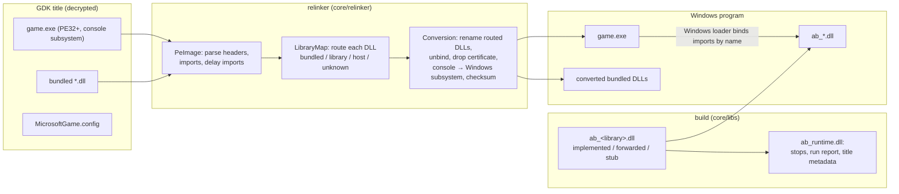

# Architecture

How a GDK executable becomes a Windows program. Nothing is emulated: the converted executable runs as a normal process and calls native implementations of the system libraries.

## Overview

## Why this works for GDK

- GDK titles are x86-64 PE32+ images, the format the Windows loader already reads. There is no instruction translation and no ABI thunking: Windows x64 has one calling convention, and console and PC code both use it.
- What differs is the environment: the subsystem field (14, the console subsystem), the console-only system DLLs the title imports (XGameRuntime, D3D12.X, kernelx and others), and the hardware behind them.

## Relinker

[`Conversion::Convert`](../../core/relinker/relinker/src/Conversion.cpp), called from [`main.cpp`](../../core/relinker/main.cpp):

1. **Parse.** [`PeImage`](../../core/relinker/pe/src/PeImage.cpp) reads the headers, sections, import and delay-import descriptors (by name and by ordinal) and exports. Only AMD64 PE32+ native images are accepted.
2. **Route.** [`LibraryMap`](../../core/relinker/relinker/src/LibraryMap.cpp) resolves each imported DLL, first match wins:
   1. **bundled:** a DLL the title ships, from the input's folder or a `--module-dir`. Its name is kept, and it is converted too.
   2. **library:** a pattern in some `core/libs/xdll/<name>/Imports.txt`. The import is renamed to `ab_<name>.dll`.
   3. **host:** a pattern in [`HostDlls.txt`](../../core/relinker/HostDlls.txt): the desktop OS provides it unchanged (API sets, the CRT, `kernel32`).
   4. **unknown:** conversion fails and names the DLL, unless `--allow-unknown`.
   An import by ordinal from a library must be pinned in that library's `Ordinals.txt`, or conversion fails and names it.
   CMake generates the table from these files at configure time ([`cmake/LibraryMap.cmake`](../../cmake/LibraryMap.cmake)), so adding a library needs no relinker change.
3. **Rewrite.** New DLL names go in an appended `.abximp` section, and each descriptor's name RVA is pointed at them. Descriptors, thunks and the IAT stay where they are, so code that calls through the IAT is unaffected. Bound imports are unbound (the IAT is restored from the lookup table). The Authenticode certificate is dropped, because the image no longer matches it. The subsystem becomes Windows GUI (or console with `--console`), and the checksum is recomputed.
4. **Report.** `--registry` writes `<output>.registry.json` with every import and its route; `tools/import_audit.py` reads PE files directly for the same view against the library sources.

## Libraries

- Each folder in [`core/libs/xdll`](../../core/libs/xdll) builds `ab_<name>.dll` through `anybox_add_xdll` ([`core/libs/CMakeLists.txt`](../../core/libs/CMakeLists.txt)).
- An export is one of:
  - **implemented:** an `ABX_API` definition (`extern "C" __declspec(dllexport)`);
  - **forwarded:** a `Name=hostdll.Name` line in `Forwards.def`, which the Windows loader resolves to the host DLL;
  - **stub:** an `ABX_API` definition whose body calls `AbxNotImplemented(__func__)`.
- [`ab_runtime.dll`](../../core/libs/runtime/src/Runtime.cpp) is shared by every library:
  - `AbxNotImplemented` / `AbxUnsupported` log the library and function, write the run report and end the process with exit code `0xAB01` / `0xAB02`. A title cannot catch these.
  - An unhandled exception filter writes the report for crashes (code, address, module and offset).
  - At normal process exit the report is written with `stop.kind = "none"`.
  - `AbxTitleId()`, `AbxTitleName()` and `AbxTitleDeviceFamily()` read `MicrosoftGame.config` beside the executable.
  - `AbxTrace(format, ...)` logs through `AbxLog` on the library's channel when `ANYBOX_TRACE` lists that library (or `all`); each call site asks `AbxTraceEnabled` once, so a trace that is off costs one branch.
  - Each library registers itself at load ([`Registration.cpp`](../../core/libs/runtime/src/Registration.cpp)), so the report lists the libraries the title loaded.
- Libraries link their C++ runtime statically, so the output folder needs no MinGW DLLs.

## Graphics (d3d12_x)

Console shaders carry native GPU code and no DXIL, so `d3d12_x` cannot hand them to a desktop driver. The design is on [#4](https://github.com/Dark3581/AnyBox/issues/4): the title's D3D12.X device goes to Vulkan, and its shaders are SPIR-V modules translated ahead of time by a separate tool. `d3d12_x` uses two back ends:

- **Host `d3d12.dll`** ([`RootSignature.cpp`](../../core/libs/xdll/d3d12_x/RootSignature.cpp)): `D3D12SerializeRootSignature` and `D3D12SerializeVersionedRootSignature` (with the console-only flag bits cleared) and the two deserializer creators are forwarded to it, since they need no GPU.
- **Vulkan** (`vulkan/`, `pso/`, `store/`): everything the device does. `D3D12XboxCreateDevice`, `D3D12CreateDevice` and `D3D12GetDebugInterface` still stop the title until its calls show the device's shape, so nothing reaches the pieces below yet.

- **Shader store** ([`store/ShaderStore.cpp`](../../core/libs/xdll/d3d12_x/store/ShaderStore.cpp)): modules keyed by the SHA-256 of each DXBC container, loaded from `ANYBOX_SHADER_STORE` or `shaders` beside the executable. [`tools/build_shaders.py`](../../tools/build_shaders.py) and the `shaders` target build it from a package ([GAME_TESTING](GAME_TESTING.md#building-shaders-with-the-project)).
- **Device** ([`vulkan/VulkanDevice.cpp`](../../core/libs/xdll/d3d12_x/vulkan/VulkanDevice.cpp)): a Vulkan 1.3 device with exactly the features the store's modules name; [`VulkanBackend.cpp`](../../core/libs/xdll/d3d12_x/vulkan/VulkanBackend.cpp) reports what each GPU offers (`anybox-gpu-report`, `tools/gpu_report.py`).
- **Layout** ([`vulkan/TitleLayout.cpp`](../../core/libs/xdll/d3d12_x/vulkan/TitleLayout.cpp)): every pipeline uses one layout, set 0 with twenty bindless bindings and 144 bytes of push constants, the interface the translated modules declare (`tools/spirv_layout.py` checks a store against it).
- **Pipelines** ([`vulkan/PipelineCompiler.cpp`](../../core/libs/xdll/d3d12_x/vulkan/PipelineCompiler.cpp)): compute pipelines from stored modules, a pipeline cache reused only on the same GPU and driver, and large modules compiled one at a time.
- **Pipeline state** ([`pso/PipelineState.cpp`](../../core/libs/xdll/d3d12_x/pso/PipelineState.cpp), [`vulkan/PipelineLibrary.cpp`](../../core/libs/xdll/d3d12_x/vulkan/PipelineLibrary.cpp)): a compute pipeline state description is resolved to its stored module through the hash of its shader container, and the library creates each pipeline once, cache first. It asks the driver for the pipeline without compiling (`VK_PIPELINE_CREATE_FAIL_ON_PIPELINE_COMPILE_REQUIRED_BIT`); only when that fails does it compile, and a module over the run-time compile limit is refused instead. Some modules need more memory to compile than a PC can commit, so the offline `shader_pipelines` run fills the cache that the title then only loads. The title's own cached pipeline blobs are ignored, because they hold console GPU code.
- **Graphics state** ([`pso/GraphicsState.cpp`](../../core/libs/xdll/d3d12_x/pso/GraphicsState.cpp), [`vulkan/GraphicsPipeline.cpp`](../../core/libs/xdll/d3d12_x/vulkan/GraphicsPipeline.cpp)): a graphics pipeline state description's blend, rasterizer, depth-stencil, sample, topology class and target formats become Vulkan state, and pipelines use dynamic rendering. Viewports, scissors, blend constants, stencil reference, the exact topology, primitive restart and vertex buffer strides are dynamic, because D3D12 sets them while recording. `GraphicsPipelineRequest` ([`pso/PipelineState.cpp`](../../core/libs/xdll/d3d12_x/pso/PipelineState.cpp)) resolves a graphics description's vertex, geometry and pixel shaders through the store and hands the whole pipeline to the library, cache first like compute.
- **Root signatures** ([`pso/RootSignatureLayout.cpp`](../../core/libs/xdll/d3d12_x/pso/RootSignatureLayout.cpp)): a root signature blob is deserialized through the host `d3d12.dll` and laid out as parameters with their 32-bit word cost, tables and ranges, and static samplers as Vulkan samplers; the mapping of those words to the shaders' user registers is still open.
- **Vertex input** ([`pso/VertexInput.cpp`](../../core/libs/xdll/d3d12_x/pso/VertexInput.cpp)): a translated vertex shader reads each input at the location of its D3D input register, so the input layout is matched to the vertex shader's inputs by semantic name and index, which the store keeps in `inputs.txt`.
- **Resource states** ([`commands/ResourceState.cpp`](../../core/libs/xdll/d3d12_x/commands/ResourceState.cpp)): D3D12 resource states become Vulkan stages, access masks and image layouts, so a transition, UAV or aliasing barrier becomes a `vkCmdPipelineBarrier2` dependency (the device enables `synchronization2`).
- **Command recording** ([`commands/CommandRecorder.cpp`](../../core/libs/xdll/d3d12_x/commands/CommandRecorder.cpp), [`commands/CopyLayout.cpp`](../../core/libs/xdll/d3d12_x/commands/CopyLayout.cpp)): clears, buffer and texture copies through placed footprints, texture copies, resolves, render passes, viewports (with a negative height, so D3D12's winding applies), scissors, topology, vertex and index buffers, push constants, draws, dispatches and indirect draws and dispatches ([`commands/IndirectCommands.cpp`](../../core/libs/xdll/d3d12_x/commands/IndirectCommands.cpp), with count buffers) recorded on a Vulkan command buffer, with layouts from the D3D12 states.
- **Textures** ([`resources/TextureDesc.cpp`](../../core/libs/xdll/d3d12_x/resources/TextureDesc.cpp)): a texture's resource description becomes a Vulkan image description, with typeless and block-compressed formats, depth families, mip chains, multisampling and cube compatibility.
- **Views and samplers** ([`resources/ViewDesc.cpp`](../../core/libs/xdll/d3d12_x/resources/ViewDesc.cpp)): shader resource, unordered access, render target and depth-stencil view descriptions become Vulkan image views (format family, depth or stencil aspect, swizzle, mip and array range), and sampler descriptions become Vulkan samplers.
- **Buffer descriptors** ([`resources/BufferDescriptor.cpp`](../../core/libs/xdll/d3d12_x/resources/BufferDescriptor.cpp)): constant buffer and buffer shader resource and unordered access views become the four-word buffer descriptors the translated shaders decode (base address, stride, records, component selects, format and bounds mode).
- **Memory access** in a translated shader takes one of two paths:
  - images and samplers: the shader looks its T# or S# up in the descriptor hash table at binding 2 ([`vulkan/DescriptorTable.cpp`](../../core/libs/xdll/d3d12_x/vulkan/DescriptorTable.cpp)) and gets a bindless index into set 0 ([`vulkan/BindlessSet.cpp`](../../core/libs/xdll/d3d12_x/vulkan/BindlessSet.cpp)), with fallbacks at index 0;
  - buffers and scalar loads: the shader adds the heap base to the console address it read, so a title's buffers and descriptor tables have to sit in one buffer-device-address range, below 4 GB for descriptor tables ([`vulkan/TitleBufferWindow.cpp`](../../core/libs/xdll/d3d12_x/vulkan/TitleBufferWindow.cpp)).
- `anybox-pipeline-probe` drives each piece on the GPU (`selftest`, `validation`, `bindless`, `window`, `compile`); the `pso_probe` test program drives pipeline state descriptions through the store and the library.

Not built yet, because they follow from a title's own calls: `D3D12XboxCreateDevice` and the device's methods (so nothing calls the pipeline state paths yet), command queues and lists, resources and descriptor heaps, mesh pipelines, presentation, and which allocations go to the buffer window. Each open point is in [debt/d3d12_x.md](debt/d3d12_x.md).

## Run report

`anybox-report.json`, schema [docs/run-report.schema.json](../run-report.schema.json), fixtures in [docs/run-report-fixtures](../run-report-fixtures). A value the runtime cannot know is `null`, never a guess.

## Tests

- [`relinker_tests`](../../core/relinker/tests/RelinkerTests.cpp) build synthetic console PE images in memory ([`SyntheticPe.cpp`](../../core/relinker/tests/SyntheticPe.cpp)) and check routing, unbinding, certificate removal, delay imports, header room and checksums.
- [`e2e.py`](../../core/libs/tests/e2e.py) takes a real title built against a stand-in console `xgameruntime.dll`, marks it with the console subsystem, relinks it, runs it on the AnyBox libraries, and checks its output and run report for a working task queue run, composite queues sharing ports, task queue monitors and waiters (including a monitor unregistering itself and a termination waited from the queue's own dispatched callback), XAsync calls (run, wait, provider ops, results, cancellation, a terminated queue and a null block), XGameSave containers and blobs written, read, enumerated and deleted in a per-title folder, a stub stop, an unsupported stop, a crash and the reported device type.
